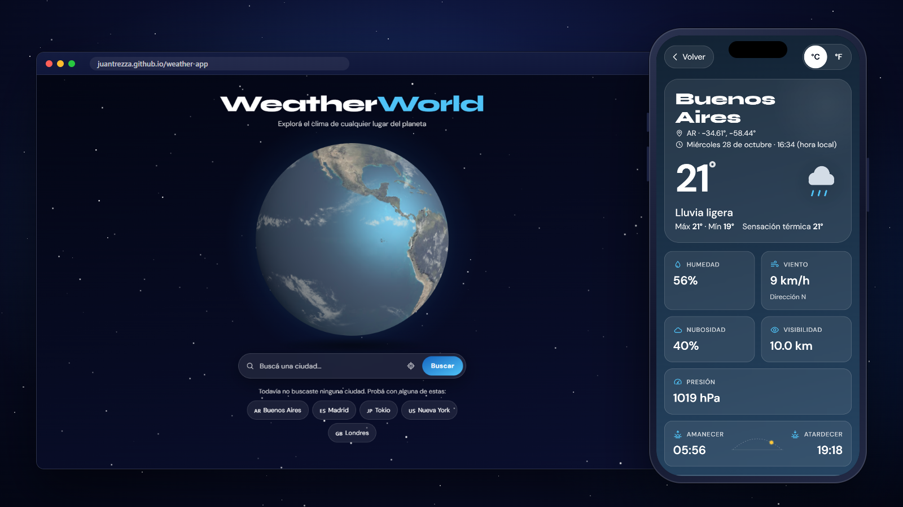

# 🌍 WeatherWorld — Clima Global

El clima de cualquier lugar del planeta, con un globo 3D que gira hasta la ciudad que buscás. Se instala como app y funciona sin conexión.


**🔗 Demo:** [juantrezza.github.io/weather-app](https://juantrezza.github.io/weather-app/)



<!-- Demo animada: guardala como docs/demo.gif y descomentá la línea de abajo -->
<!--  -->

## ✨ Funcionalidades

### 🔍 Búsqueda y autocompletado
- Sugerencias de ciudades mientras escribís (combobox accesible con teclado), con bandera y país para distinguir homónimas.
- Búsqueda por coordenadas al elegir una sugerencia: no hay ambigüedad entre "Córdoba, AR" y "Córdoba, ES".
- Botón de ubicación actual, con mensajes distintos para permiso denegado, señal no disponible y tiempo agotado.
- Historial de las últimas búsquedas y ciudades populares para empezar.

### 🌤️ Clima y pronóstico
- Temperatura, sensación térmica, humedad, viento con punto cardinal, visibilidad, presión, amanecer y atardecer.
- Hora y fecha locales de la ciudad, no las del navegador.
- Pronóstico de 5 días con máxima y mínima.
- Toggle °C / °F sin volver a pedir datos.
- El fondo cambia según el clima y la hora del día en la ciudad.

### 📈 Gráfico de las próximas 24 horas
- Curva de temperatura en SVG, sin librerías, con probabilidad de lluvia por franja.
- Números en DM Sans con cifras tabulares para que no "bailen".
- Tabla equivalente para lectores de pantalla.

### 🌐 Globo 3D
- Three.js con texturas de la NASA: relieve, brillo del océano y capa de nubes.
- Gira hasta la ciudad encontrada y la marca con un punto que late.
- Se arrastra con el mouse o con el dedo.
- Carga en segundo plano: primero se ve una imagen del globo y el 3D aparece con un fundido, así la página se pinta enseguida.

### 📲 PWA y modo sin conexión
- Instalable en Android, Chrome y Edge (botón "Instalar app") y en iOS (Compartir → Agregar a inicio).
- Sin conexión carga igual: la app, el globo y las fuentes quedan en caché.
- Se puede ver el último clima consultado y volver a buscar las ciudades ya consultadas.
- Al volver la conexión ofrece actualizar, y avisa cuando hay una versión nueva de la app.

### ♿ Accesibilidad
- Contraste AA en todos los temas (verificado con script).
- Navegación completa con teclado y foco visible.
- Anuncios con `aria-live` para resultados y errores.
- Respeta "reducir movimiento": el globo no auto-rota y las animaciones se apagan.
- Áreas táctiles de 44 px y diseño mobile first, con soporte de notch (safe areas).

## 🏗️ Arquitectura

```
┌──────────────────────────┐   GET /api/weather?city=…     ┌───────────────────────────┐   ?q=…&appid=KEY   ┌──────────────┐
│  App (React + Vite)      │ ────────────────────────────▶ │  Worker (Cloudflare)      │ ─────────────────▶ │  OpenWeather │
│  GitHub Pages            │ ◀──────────────────────────── │  weather-world-api        │ ◀───────────────── │  API         │
│  + service worker (PWA)  │   JSON (sin la key)           │  CORS · rate limit ·      │                    └──────────────┘
└──────────────────────────┘                               │  validación · caché       │
                                                           │  secret: OPENWEATHER_KEY  │
                                                           └───────────────────────────┘
```

**¿Por qué la key nunca llega al navegador?** El frontend solo conoce la URL del Worker y nunca arma una URL de OpenWeather. La key vive como *secret* de Cloudflare y el Worker la agrega del lado del servidor, en el pedido a OpenWeather. No aparece en el código del frontend, ni en el bundle, ni en las respuestas, ni en los logs (el Worker solo registra el nombre del error, porque la URL lleva la key). Tampoco está en la clave de la caché, que se arma únicamente con los parámetros normalizados.

### 🔒 Seguridad del Worker

| Capa | Qué hace |
|---|---|
| **CORS con lista de orígenes** | Solo responde a `https://juantrezza.github.io` y a los orígenes locales de desarrollo; cualquier otro origen recibe `403`. |
| **Rate limit** | 30 pedidos por minuto por IP (binding `ratelimits` de Cloudflare); el exceso recibe `429` con `Retry-After`. |
| **Validación** | `city` hasta 100 caracteres; `lat`/`lon` solo como decimales simples y dentro de rango (redondeados a 4 decimales, unos 11 m); `limit` del geocoding de 1 a 5. Cualquier otra cosa recibe `400` con un mensaje claro. |
| **Caché** | Clima y pronóstico se cachean 10 minutos y el geocoding 1 día, en la caché del edge (`caches.default`). Las búsquedas repetidas no gastan cuota de OpenWeather. |
| **Errores** | Los errores de OpenWeather se traducen a mensajes en castellano; los pedidos que tardan demasiado se cortan con un timeout. |

| Endpoint | Parámetros |
|---|---|
| `GET /api/weather` | `city` o `lat` + `lon` |
| `GET /api/forecast` | `city` o `lat` + `lon` |
| `GET /api/geocode` | `q`, `limit` (1–5) |

## 🔄 De v1 a v2

La versión original sigue disponible en la rama [`v1-backup`](https://github.com/JuanTrezza/weather-app/tree/v1-backup).

| | v1 | v2 |
|---|---|---|
| **Stack** | HTML + CSS + JavaScript vanilla en un solo `app.js` | React 19 + TypeScript strict + Vite + Tailwind |
| **API key** | En el código del frontend, visible para cualquiera | Protegida en un Cloudflare Worker |
| **Búsqueda** | Texto libre | Autocompletado, búsqueda por coordenadas, historial y ciudades populares |
| **Globo** | Three.js por CDN | Three.js por npm, cargado en segundo plano; gira hasta la ciudad |
| **Datos** | Clima actual y 5 días | Además, un gráfico de 24 horas |
| **Offline** | No funciona | PWA instalable con modo sin conexión |
| **Accesibilidad** | aria-labels básicos | Contraste AA, teclado, `aria-live`, reduced motion |
| **Deploy** | Archivos estáticos | GitHub Actions → Pages, y Worker con wrangler |

## 🚦 Lighthouse

Lighthouse 13.6 sobre el build de producción. Cada valor es la mediana de 3 corridas.

| | Performance | Accessibility | Best Practices | SEO | LCP | TBT | CLS |
|---|:-:|:-:|:-:|:-:|:-:|:-:|:-:|
| 📱 Mobile | **95** | **100** | **100** | **100** | 2,3 s | 196 ms | 0 |
| 🖥️ Escritorio | **100** | **100** | **100** | **100** | 0,5 s | 0 ms | 0 |

Cómo se llegó ahí (mobile pasó de 72 a 95):

- **El globo 3D no bloquea la primera pintura:** primero se muestra una imagen del globo de 30 KB, precargada, y Three.js se baja con `import()` cuando el navegador queda libre. La escena se arma por pasos cortos, cediendo el hilo principal entre uno y otro.
- **Texturas:** pasaron a WebP; normales y specular se cargan después del primer frame y se decodifican fuera del hilo principal con `createImageBitmap`. Pasaron de 1,3 MB a 580 KB sin diferencias visibles.
- **Render del globo:** resolución limitada a 2x (1,5x en pantallas chicas) y pausa cuando no se ve (otra pantalla, fuera del viewport o pestaña oculta).
- **Fuentes:** locales y variables, solo el subset latino, con `font-display: swap` y una fuente de respaldo con las métricas de DM Sans, así el cambio de fuente no mueve nada.
- **Sin layout shift:** el lugar del botón "Instalar app" queda reservado antes de que llegue el evento del navegador.

## 💻 Cómo correrlo en local

Requisitos: Node 20.19 o superior y una API key gratuita de [OpenWeather](https://openweathermap.org/api).

**1. Worker (API)**

```bash
cd worker
npm install
cp .dev.vars.example .dev.vars   # en Windows: copy .dev.vars.example .dev.vars
# Editá .dev.vars y reemplazá tu-api-key por tu key: OPENWEATHER_API_KEY=tu-api-key
npx wrangler dev                 # http://127.0.0.1:8787
```

`.dev.vars` está en `.gitignore`: tu key nunca se sube al repo.

**2. App**

```bash
npm install
npm run dev                      # http://localhost:5173/weather-app/
```

En desarrollo la app usa el Worker local (`http://127.0.0.1:8787`).

**3. PWA (service worker)**

El service worker solo existe en el build:

```bash
npm run build
npm run preview -- --port 5173   # http://localhost:5173/weather-app/
```

El build apunta al Worker de producción, que acepta `localhost:5173` como origen.

**Deploy:** cada push a `main` publica la app en GitHub Pages (Settings → Pages → Source: GitHub Actions). El Worker se publica aparte:

```bash
cd worker
npx wrangler secret put OPENWEATHER_API_KEY   # pide la key de forma interactiva
npx wrangler deploy
```

Si usás tu propio Worker, cambiá la URL de producción en `API_URL` (`src/services/weatherApi.ts`) y los orígenes en `worker/wrangler.jsonc`.

## 📁 Estructura

```
weather-app/
├── index.html                 # Entrada de Vite (preload de fuentes y de la imagen del globo)
├── vite.config.ts             # Base /weather-app/, PWA (manifest + Workbox) y chunk de Three.js
├── public/                    # Íconos de la PWA y favicon
├── src/
│   ├── App.tsx                # Pantallas, búsqueda, modo sin conexión
│   ├── components/            # Globe (imagen + carga diferida) y GlobeCanvas (Three.js), SearchBar,
│   │                          # WeatherHero, HourlyChart, Forecast, Details, banners y toasts
│   ├── hooks/                 # useWeather, useCitySuggestions, useHistory, useOnline, useInstallPrompt…
│   ├── services/              # Cliente del Worker con caché, último clima guardado
│   ├── utils/                 # Hora local, temas por clima, gráfico, lugares, viento
│   ├── styles/global.css      # Tailwind, fuentes locales, temas y animaciones
│   └── assets/                # Texturas del globo (WebP), fuentes (OFL) y fuente del ícono
├── worker/                    # Cloudflare Worker: CORS, rate limit, validación y caché
│   ├── src/index.ts
│   ├── src/validate.ts
│   └── wrangler.jsonc
├── docs/                      # Capturas para este README
└── .github/workflows/         # Deploy a GitHub Pages
```

## 🙌 Créditos

- Datos: [OpenWeather](https://openweathermap.org/).
- Texturas de la Tierra: NASA, vía los ejemplos de [Three.js](https://threejs.org/), convertidas a WebP.
- Fuentes: [Syne](https://gitlab.com/bonjour-monde/fonderie/syne-typeface) y [DM Sans](https://github.com/googlefonts/dm-fonts), bajo licencia SIL Open Font License ([src/assets/fonts/OFL.txt](src/assets/fonts/OFL.txt)).

## 👤 Autor

**Juan Moreno Trezza**

- Portfolio: [juantrezza.github.io/porfolio](https://juantrezza.github.io/porfolio)
- GitHub: [@JuanTrezza](https://github.com/JuanTrezza)
